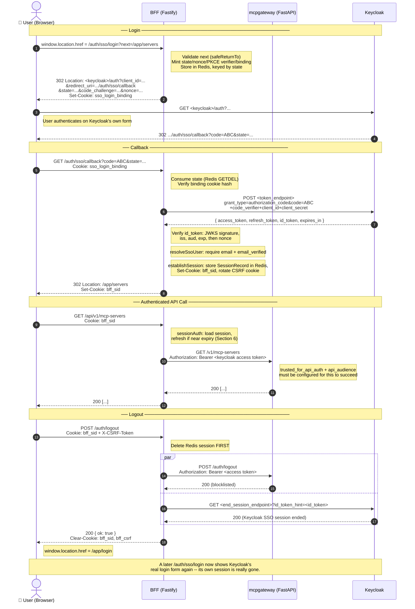

# Keycloak SSO — End-to-End

This document traces the full Keycloak single sign-on flow this BFF
implements: login, session bootstrap, token refresh, API proxying, and
logout (including the back-channel Keycloak logout). For _setting up_ SSO
against a real Keycloak (client registration, env vars, the gateway-side
admin step), see [`sso-keycloak-setup.md`](./sso-keycloak-setup.md) instead —
this doc is the architecture trace, not the operator guide. Same split as
[`OAUTH.md`](./OAUTH.md) draws for the MCP OAuth flow.

---

## Table of Contents

1. [Why a Separate OIDC Client](#1-why-a-separate-oidc-client)
2. [Login — `GET /auth/sso/login`](#2-login--get-authssologin)
3. [Callback — `GET /auth/sso/callback`](#3-callback--get-authssocallback)
4. [Session Bootstrap — What Gets Stored](#4-session-bootstrap--what-gets-stored)
5. [Every Authenticated Request — `sessionAuth`](#5-every-authenticated-request--sessionauth)
6. [Token Refresh](#6-token-refresh)
7. [API Proxying — The Gateway's Side](#7-api-proxying--the-gateways-side)
8. [Logout](#8-logout)
9. [Full Flow Diagram](#9-full-flow-diagram)
10. [Error Handling](#10-error-handling)
11. [Relevant Source Files](#11-relevant-source-files)

---

## 1. Why a Separate OIDC Client

mcpgateway has its own `/auth/sso/*` flow, but it isn't usable directly from
this SPA — the gateway and the BFF are typically on different origins, and
the gateway's flow isn't designed to hand a session back to a third party.
So this BFF runs its **own** Authorization Code + PKCE client against the
same Keycloak realm, independent of the gateway's.

One consequence: the bearer token this BFF ends up holding for a logged-in
user is a **Keycloak-issued access token**, not a gateway-issued JWT. Section
7 covers what that means for proxied API calls.

---

## 2. Login — `GET /auth/sso/login`

**File:** `server/src/routes/auth/sso-login.ts`

The SPA never calls this as `fetch()` — `Login.tsx`'s SSO button does a full
top-level navigation:

```ts
window.location.href = `/auth/sso/login?next=${encodeURIComponent(returnTo)}`;
```

A full navigation, not a fetch, because the response is a `302` to Keycloak's
own login page — there's nothing for client-side JS to do with that.

The route:

1. **Validates `next`** (`safeReturnTo`) — must be an `/app`-rooted relative
   path with no `scheme://`, no `//host`, and no `..`, mirroring the SPA
   router's own `validateDestination`. Anything else falls back to `/app/`.
   This is the login flow's only attacker-controlled input, so it's the only
   thing checked before any state is minted.
2. Bails out early (redirecting back to `/app/login?error=sso_<code>`) if SSO
   is disabled or the request fails the login-CSRF cross-origin check — no
   session exists yet to hijack at this point, but a hostile page could still
   force a victim's browser through an unwanted login attempt.
3. Fetches Keycloak's **OIDC discovery document** (`oidc-discovery.ts`,
   cached 1h) for the `authorization_endpoint`.
4. Computes its own `redirect_uri` — **not** `window.location.origin`, which
   would break behind a reverse proxy — from `resolvePublicOrigin(request)`,
   the same trusted-origin resolution `OAUTH.md` describes for the OAuth
   flow's redirect URI.
5. **Mints one-time login state** (`sso-login-state.ts`):
   - `state` (UUID) — the Redis key.
   - `nonce` (UUID) — carried through to the ID token, checked at callback.
   - PKCE `code_verifier`/`code_challenge` (S256) — RFC 7636.
   - `binding` — a random value set as an **httpOnly cookie**
     (`sso_login_binding`); only its hash is stored server-side, so a Redis
     dump alone can't forge it. Ties the eventual callback to _this browser_,
     not just to someone who captured the `state` value off the wire.

   The whole record (`codeVerifier`, `nonce`, `returnTo`, `redirectUri`,
   `bindingHash`) is stored in Redis keyed by `state`, TTL
   `SSO_LOGIN_STATE_TTL_SECONDS` (default 300s).

6. Redirects to Keycloak's authorize endpoint with
   `response_type=code&client_id=...&redirect_uri=...&scope=...&state=...&code_challenge=...&code_challenge_method=S256&nonce=...`.

The browser now leaves this app entirely and lands on Keycloak's own login
form.

---

## 3. Callback — `GET /auth/sso/callback`

**File:** `server/src/routes/auth/sso-callback.ts`

Keycloak redirects back here after the user authenticates, with
`?code=...&state=...` (or `?error=...&state=...` if they denied consent or
something went wrong on Keycloak's side).

1. **Consumes the login state unconditionally**, before even checking for an
   `error` param — a GETDEL against `state`, validated against the
   `sso_login_binding` cookie's hash (`timingSafeEqual`, not `===`). This is
   single-use: a replayed `state` (same value, second request) finds nothing
   in Redis the second time. Consuming it even on an error path matters too
   — otherwise a user who cancels at Keycloak leaves a live, bound login
   state sitting in Redis for the rest of its TTL.
2. If Keycloak reported `?error=...`, redirects to the login page with that
   code (`sso_<keycloak's error>`), preserving `returnTo` from the now-consumed
   state.
3. Re-fetches the discovery document for the `token_endpoint`, then
   **exchanges the code** (`sso-token-exchange.ts`):
   ```
   POST <token_endpoint>
   grant_type=authorization_code&code=...&redirect_uri=...
   &client_id=...&client_secret=...&code_verifier=...
   ```
   `redirect: "error"` on the fetch — a redirect here would resend
   `client_secret` to wherever it points. The response carries
   `access_token`, `refresh_token` (if Keycloak issues one for this client),
   `id_token`, and `expires_in`.
4. **Verifies the ID token** (`sso-user-resolution.ts`'s `verifySsoIdToken`):
   - Must be RS256 (Keycloak's default; other algorithms are rejected
     outright — no algorithm-confusion surface).
   - Signature checked against the realm's JWKS (`getJwks`, cached 1h),
     matched by `kid` (or the sole key, if Keycloak only publishes one).
   - `iss` must equal the discovery document's own issuer.
   - `aud` must include this client's ID.
   - `exp` must not have passed (60s clock-skew allowance).
5. **Checks the `nonce`** from the verified claims against the one minted at
   login — this is _not_ part of `verifySsoIdToken` itself, because only the
   callback route knows which login attempt this is. A mismatch means the ID
   token wasn't issued for this specific authorization request.
6. **Resolves the user** (`resolveSsoUser`):
   - Requires `email` — missing it is `email_missing`.
   - Requires `email_verified: true` — an unverified, federated email could
     collide with an existing local account; trusting it would let an
     attacker take over that account just by claiming the same address at
     the IdP. This is `email_unverified`, a distinct error code from
     `email_missing` for the login page to render.
   - `full_name` from `name`, falling back to `preferred_username`.
   - `is_admin: false` always — RBAC stays entirely gateway-side; this flag
     is cosmetic only (see `AuthContext.tsx`'s own `hasPermission` caveat).
7. **Establishes the session** — see Section 4.
8. Redirects to the original `returnTo` from the (consumed) login state.

Every failure path in this route redirects to `/app/login?error=sso_<code>`
rather than rendering raw JSON or throwing a 500 — the only caller is a
top-level browser navigation, so there's no client-side code waiting to
parse an error body.

---

## 4. Session Bootstrap — What Gets Stored

**File:** `server/src/lib/establish-session.ts`

`establishSession()` is the single chokepoint both SSO and password login
funnel through (see its own doc comment). For SSO, the callback calls it
with:

```ts
await establishSession(
  fastify,
  request,
  reply,
  { access_token: tokens.accessToken, expires_in: tokens.expiresIn, user },
  { refreshToken: tokens.refreshToken, idToken: tokens.idToken },
);
```

Note **`access_token` here is Keycloak's own access token** — not anything
the gateway issued. This is the detail Section 7 depends on.

What it does:

- **TTL decision**: the Redis session (and the `bff_sid` cookie's `maxAge`)
  get `config.sessionTtlSeconds` _only if_ `ssoTokens.refreshToken` is
  present. Otherwise (an SSO response that omitted it, or a password login)
  they get the upstream's usable `expires_in` when there is one, falling back
  to the full `config.sessionTtlSeconds` when `expires_in` is missing or
  invalid. For an SSO session that fallback case is then ended by
  `tokenExpiresAt` (stamped at `now + 0`, see below) on the very next
  request, not by the cookie's own TTL.
  Rationale: a session with no refresh token can never be extended once the
  access token expires, so a long-lived cookie around a short-lived token
  would just mean every proxied call 401s for the remainder of the cookie's
  life. Password-login sessions carry no `ssoTokens`, so no `tokenExpiresAt`
  is stamped and `sessionAuth` never expiry-checks them; they rely on the
  cookie/Redis TTL above.
- **`tokenExpiresAt`** is stamped as `now + expires_in` (0 if Keycloak didn't
  send one) — the single source of truth `sessionAuth` later checks against,
  not re-derived from the JWT's own `exp` claim.
- **CSRF rotation**: deletes any pre-existing `bff_csrf` cookie before
  minting a fresh one. Without this, a secret planted before login (a
  subdomain XSS, or a plaintext hop with `COOKIE_SECURE=false`) would survive
  into the authenticated session.
- Stores the `SessionRecord` (`bearerToken`, `refreshToken`, `idToken`,
  `tokenExpiresAt`, `user`) in Redis under a fresh `sessionId`, sets the
  `bff_sid` cookie (httpOnly, `sameSite: lax`), and returns the CSRF token for
  the SPA to echo back as `X-CSRF-Token` on future state-changing calls.

The browser only ever sees the opaque `bff_sid` — the Keycloak access/refresh
tokens and the ID token never leave the BFF.

---

## 5. Every Authenticated Request — `sessionAuth`

**File:** `server/src/plugins/session.ts`

Every proxied `/api/*` call (and the SSE and OAuth-popup proxy routes) runs
through the `sessionAuth` preHandler first. `GET /auth/session` and
`POST /auth/logout` do **not** — see the end of this section.

1. No `bff_sid` cookie → `401 unauthenticated`.
2. No matching Redis record → `401 session_expired`.
3. **`needsRefresh(record)`**: true only if there's a `refreshToken`, a
   `tokenExpiresAt`, the access token is within `SSO_TOKEN_REFRESH_LEEWAY_SECONDS`
   of expiring (default 30s), and we're not inside a post-failure
   `refreshRetryAfter` backoff window. Password-login sessions (no
   `refreshToken`) never hit this branch at all.
4. If a refresh is needed, acquires a **per-session Redis lock**
   (`refreshRecordWithLock`) so concurrent requests near expiry don't each
   fire their own `refresh_token` grant — Keycloak's refresh tokens can
   rotate, so a second concurrent refresh with an already-superseded token
   would just fail. A request that loses the lock race polls briefly for the
   winner to finish, then re-reads the (by-then-refreshed) record instead of
   refreshing itself.
5. **`isActuallyExpired(record)`** — checked _after_ any refresh attempt,
   unconditionally. A transient Keycloak outage can leave `refreshRetryAfter`
   set without touching the real `tokenExpiresAt`; this check is what
   guarantees a BFF never forwards a bearer token past its genuine deadline,
   even mid-outage.
6. Either outcome failing calls **`endSession`** — deletes the Redis record,
   clears the cookie, responds `401 session_expired`. This is the same
   revoke-on-failure shape `catch-all.ts`'s own upstream-401 handling uses
   (Section 7) — a session that can't produce a live bearer token stops
   looking authenticated immediately, not just once its TTL naturally lapses.

On success, `request.session = { sessionId, bearerToken, user }` — everything
downstream (the proxy, SSE and OAuth routes) reads from here, never from
Redis directly.

### Routes that do not run `sessionAuth`

The refresh and expiry guarantees above apply only to routes that install
`sessionAuth`. Two BFF-owned routes deliberately don't:

- **`GET /auth/session`** (`routes/auth/session.ts`) reads the Redis record
  directly. It never checks `tokenExpiresAt` or attempts a refresh, so a
  session whose SSO access token has expired can still return
  `authenticated: true` until a protected request runs `sessionAuth` and
  removes the record.
- **`POST /auth/logout`** is guarded by `csrfProtection` only, so it works
  even when the session is already expired or missing (Section 8).

---

## 6. Token Refresh

**File:** `server/src/lib/sso-token-refresh.ts`, called from `plugins/session.ts`

A refresh is a `POST` to the same Keycloak token endpoint as the initial
exchange, just with `grant_type=refresh_token`:

```
POST <token_endpoint>
grant_type=refresh_token&refresh_token=...&client_id=...&client_secret=...
```

Two failure shapes, deliberately distinguished:

- **`"rejected"`** — Keycloak's own RFC 6749 error code was `invalid_grant`.
  The refresh token is actually dead (revoked, expired, already used if
  Keycloak rotates them). `sessionAuth` treats this as a hard failure →
  `endSession`.
- **`"unreachable"`** — network error, timeout, a non-JSON body, or _any
  other_ 4xx/5xx (rate-limited, momentarily unavailable, a desynced
  `client_secret`). None of these say the refresh token itself is bad.
  `sessionAuth` treats this as transient: it keeps the pre-refresh token
  (still cryptographically valid until its real `tokenExpiresAt`), sets a
  short `refreshRetryAfter` cooldown so every request during the outage
  doesn't each pay a fresh discovery+refresh round trip, and only actually
  logs the user out once `isActuallyExpired` finally catches up.

On a successful refresh, the new `access_token`/`refresh_token`/`id_token`
overwrite the session in place (same `sessionId` — the cookie never
changes), and the cookie's `maxAge` is reset to the full session TTL. Without
that reset, the browser would drop the cookie on the _original_ login's
schedule even though Redis stayed fresh underneath it.

---

## 7. API Proxying — The Gateway's Side

**File:** `server/src/routes/proxy/catch-all.ts`

Every `/api/*` call injects `request.session.bearerToken` as the upstream
`Authorization` header and forwards it to the gateway. Since (per Section 4)
that token is **Keycloak's own access token for an SSO session**, the gateway
has to recognize it as valid on its own terms — it isn't a token the gateway
minted.

This requires two things configured on the gateway side (covered in full in
[`sso-keycloak-setup.md`](./sso-keycloak-setup.md)):

- `SSO_API_TOKEN_AUTH_ENABLED=true`.
- The gateway's own SSOProvider row for this realm marked
  `trusted_for_api_auth: true` with an `api_audience` matching an audience
  claim the Keycloak client's access tokens actually carry.

If the gateway doesn't recognize the token (not trusted, wrong audience, or a
gateway version that doesn't dispatch external-IdP tokens on this code path
at all), it responds `401`. `catch-all.ts`'s `onResponse` hook treats any
upstream `401` as "this bearer token is dead" — it deletes the BFF session
and clears the cookie right then, rather than letting the browser keep
retrying a token that will never become valid. The SPA's existing
redirect-to-login handling takes it from there.

---

## 8. Logout

**File:** `server/src/routes/auth/logout.ts`

`POST /auth/logout` is CSRF-protected like any other state-changing BFF call.
With a valid `bff_sid`:

1. Reads the session record, then **deletes the Redis session immediately**
   — before anything else runs. The upstream revoke and back-channel logout
   below are both best-effort; neither gets to leave a live BFF session
   behind if it stalls.
2. Runs two revocations **in parallel**, both best-effort (logged on
   failure, never thrown):
   - **`revokeUpstreamToken`** (`revoke-upstream-token.ts`) — `POST
<gateway>/auth/logout` with the session's bearer token, so the
     Keycloak-issued access token also gets gateway-side blocklisted, not
     just unreachable from the browser. Without this it stays
     cryptographically valid until its own `expires_in` lapses.
   - **`backChannelLogoutSso`** (`sso-back-channel-logout.ts`) — **only if
     the session has an `idToken`** (i.e. it's an SSO session at all).
     Fetches the discovery document's `end_session_endpoint` (RP-Initiated
     Logout, OIDC) and calls it with `id_token_hint=<idToken>`. This is what
     actually ends Keycloak's own SSO session — without it, the BFF-side
     logout is cosmetic: Keycloak would silently re-approve the _next_
     `/auth/sso/login` attempt without ever showing a login form again,
     because the browser still has a live session cookie on Keycloak's own
     origin.
3. Clears both the session cookie and the CSRF cookie, responds `{ ok: true
}`.

The frontend (`AuthContext.tsx`'s `logout()`) `await`s this call before doing
anything else — the server-side logout (session delete + both revocations)
is fully complete before the browser navigates to `/app/login`.

---

## 9. Full Flow Diagram

> Rendered natively on GitHub, GitLab, Notion, Obsidian, and VS Code
> (Markdown Preview Mermaid Support extension).



---

## 10. Error Handling

Every failure in the login or callback route redirects to
`/app/login?error=sso_<code>&next=<returnTo>` rather than returning JSON or a
5xx — there's no client-side code to hand a JSON error body to, since both
hops are top-level browser navigations. `Login.tsx` renders one generic,
user-facing message for _any_ `sso_*` code (`classifyLoginError` doesn't
distinguish them) and strips the `error` param from the URL after reading it,
so a page refresh doesn't re-show the error. The specific code still reaches
the server logs for debugging — see `sso-login-error-redirect.ts`.

| Code                       | Where           | Meaning                                                                                                                                              |
| -------------------------- | --------------- | ---------------------------------------------------------------------------------------------------------------------------------------------------- |
| `disabled`                 | login           | `SSO_ENABLED=false`                                                                                                                                  |
| `cross_site_forbidden`     | login           | Login-CSRF guard rejected the request                                                                                                                |
| `discovery_failed`         | login, callback | Keycloak's `.well-known/openid-configuration` fetch failed                                                                                           |
| `callback_invalid`         | callback        | Missing `code`/`state`, or a repeated `?error=` param                                                                                                |
| `state_invalid`            | callback        | `state` not found in Redis (expired, already consumed, or forged) or binding-cookie mismatch                                                         |
| `<keycloak's own code>`    | callback        | Keycloak itself reported `?error=...` (e.g. `access_denied`)                                                                                         |
| `token_exchange_failed`    | callback        | The code→token POST failed or Keycloak rejected it                                                                                                   |
| `id_token_missing`         | callback        | Token response had no `id_token`                                                                                                                     |
| `id_token_invalid`         | callback        | Signature/iss/aud/exp verification failed, or JWKS/discovery errored                                                                                 |
| `nonce_mismatch`           | callback        | ID token's `nonce` didn't match the one minted at login                                                                                              |
| `email_missing`            | callback        | ID token had no `email` claim                                                                                                                        |
| `email_unverified`         | callback        | `email_verified` wasn't `true`                                                                                                                       |
| `password_change_required` | callback        | Can't actually happen for SSO (`resolveSsoUser` always sets it `false`) — `establishSession`'s shared backstop exists for every caller, SSO included |

---

## 11. Relevant Source Files

| File                                         | Role                                                                                   |
| -------------------------------------------- | -------------------------------------------------------------------------------------- |
| `src/pages/Login.tsx`                        | SSO button, `sso_*` error rendering                                                    |
| `src/auth/AuthContext.tsx`                   | Session bootstrap probe, `logout()`                                                    |
| `server/src/routes/auth/sso-login.ts`        | `GET /auth/sso/login` — mints state, redirects to Keycloak                             |
| `server/src/routes/auth/sso-callback.ts`     | `GET /auth/sso/callback` — code exchange, ID token verification, session establishment |
| `server/src/routes/auth/session.ts`          | `GET /auth/session` — SPA bootstrap probe, also carries `ssoEnabled`/`providerName`    |
| `server/src/routes/auth/logout.ts`           | `POST /auth/logout` — session delete + both revocations                                |
| `server/src/lib/sso-login-state.ts`          | PKCE verifier/nonce/returnTo, one-time, Redis-backed                                   |
| `server/src/lib/sso-login-error-redirect.ts` | Shared `sso_<code>` redirect builder                                                   |
| `server/src/lib/oidc-discovery.ts`           | Discovery document fetch/cache, internal/public endpoint rewriting                     |
| `server/src/lib/sso-token-exchange.ts`       | Authorization-code → tokens                                                            |
| `server/src/lib/sso-token-refresh.ts`        | `refresh_token` grant, `"rejected"` vs `"unreachable"`                                 |
| `server/src/lib/sso-user-resolution.ts`      | ID token JWKS verification, claim validation, user resolution                          |
| `server/src/lib/establish-session.ts`        | Shared session-creation chokepoint (SSO + password login)                              |
| `server/src/lib/session-store.ts`            | `SessionRecord` shape, Redis CRUD, cookie helpers                                      |
| `server/src/plugins/session.ts`              | `sessionAuth` preHandler — refresh-or-reject on every authenticated request            |
| `server/src/lib/revoke-upstream-token.ts`    | Gateway-side bearer-token blocklist call                                               |
| `server/src/lib/sso-back-channel-logout.ts`  | RP-Initiated Logout against Keycloak                                                   |
| `server/src/routes/proxy/catch-all.ts`       | Bearer injection on every proxied call; revoke-on-401                                  |
